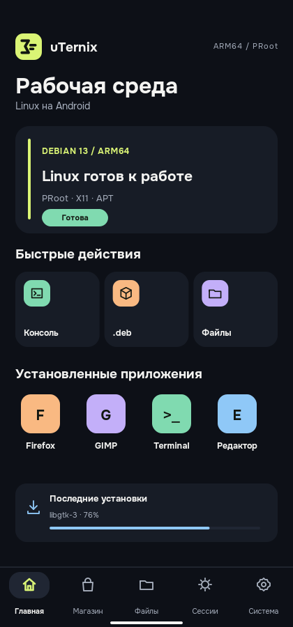
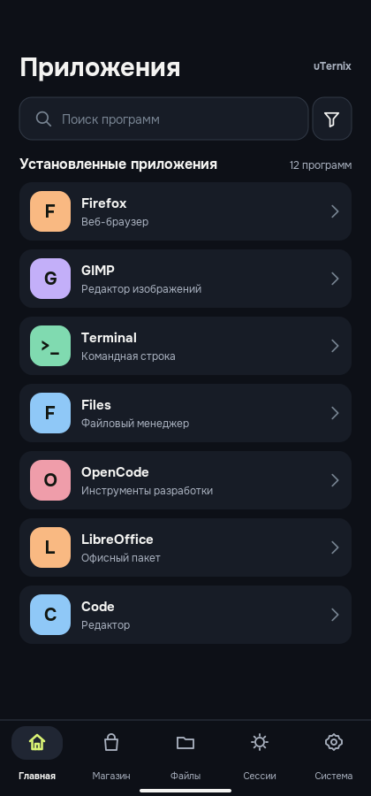
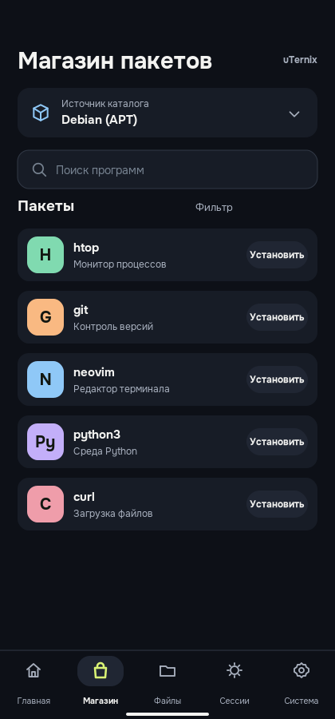
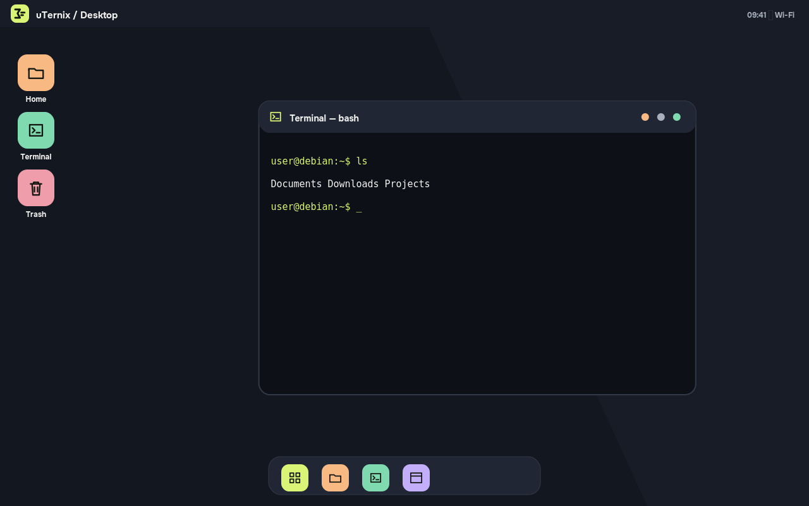

<div align="center">

# uTernix

**Linux environments and desktop applications on Android.**  
**Linux-среды и настольные приложения на Android.**

[](https://developer.android.com/)
[](#requirements--требования)
[](LICENSE)
[](https://github.com/darrkkk-a11y/uTernix---Linux-on-Android/actions/workflows/build-apk.yml)

*A community-driven Android Linux workspace built on Tessera, with PRoot, a terminal, a package catalog and optional windowed apps.*

</div>

> **Development release.** uTernix is under active development. The screenshots below are **design previews**, not proof of a device-tested APK. Builds and hardware compatibility must be verified in GitHub Actions and on Android devices before treating a release as stable.

## Preview / Предпросмотр

<table>
<tr><td align="center"><br/><sub>Home · Android phone</sub></td><td align="center"><br/><sub>Installed apps</sub></td><td align="center"><br/><sub>Linux package store</sub></td></tr>
</table>



## Features / Возможности

- **Linux engine:** create and manage a Debian guest in PRoot; chroot/Droidspaces modes may be available depending on device and privileges. **Linux-контейнер:** установка и управление Debian, PRoot без root.
- **Terminal:** direct interactive Linux shell (CUI) with familiar commands; starting the terminal does not require launching the graphical desktop. **Терминал:** настоящий Linux shell без обязательного X11.
- **Applications:** discover Linux apps dynamically and display their actual installed icons; open apps and adjust launch commands, permissions and graphics. **Приложения:** поиск, запуск и управление Linux-приложениями.
- **Packages:** APT/Debian and Flathub integration, install progress, cancellation and updates where supported. **Пакеты:** каталог Debian/Flathub и очередь установок.
- **Files and `.deb`:** browse Android and Linux files; inspect `.deb` metadata and install supported packages after Linux setup. **Файлы:** проводник и установка Debian-пакетов.
- **Desktop:** optional X11 windowed environment, sessions and task management. **Рабочий стол:** отдельный графический режим, окна и мониторинг сессий.
- **Adaptive UI:** a compact bottom navigation on portrait phones and a rail on tablets / landscape, with a dark theme and RU/EN support in new screens. **Адаптивность:** телефон, планшет, альбомная ориентация.

Some desktop, GPU and emulation functionality depends on your hardware, Linux guest, drivers and supported package architecture. Box64 amd64 compatibility is experimental.

## Requirements / Требования

| Item | Requirement |
|---|---|
| Android | Android 7.0+ (`minSdk 24`) |
| CPU | ARM64 (`arm64-v8a`); 32-bit Android not supported |
| Linux | Debian guest; initial download/storage needed |
| Root | Not required for PRoot; optional for selected other modes |
| Build | Java 17, Gradle wrapper, Android SDK 37, NDK 29, Android toolchain |

**Security:** PRoot is not a strong security sandbox. Linux applications run with the Android application's permissions. Install only trusted packages; maintainer scripts may execute during installations. This project intentionally targets an older Android SDK level to support guest binary execution, which can limit store distribution and affects the Android security model.

## Downloads / Сборки

Open the **[Releases](../../releases)** page after a first successful CI build. Each successful push to `main` (and each manual `workflow_dispatch`) is configured to create a **uniquely versioned development prerelease** with:

- `uternix-v<version>-arm64.apk` (signed release), or `uternix-v<version>-arm64-debug.apk` (installable preview);
- `uternix-v<version>-source.tar.gz` — matching complete source archive;
- `SHA256SUMS.txt` — hashes for both files.

Without signing secrets, CI builds a **debug-signed preview APK** and publishes it in a development prerelease. Its temporary CI signing key changes between runs: **uninstall the previous preview before installing another**. To receive updates without uninstalling, configure a persistent release keystore. Failed builds do **not** publish releases.

## Build / Как собрать

Clone the repository with all checked-in vendor sources:

```bash
git clone https://github.com/darrkkk-a11y/uTernix---Linux-on-Android.git
cd uTernix
python3 tools/design/check_uternix_ui.py
python3 -m unittest discover -s deb-launcher/tests -v
```

For local Android compilation you must stage Box64 and the pinned Tessera native dependencies (see [build-tools-local/README.md](build-tools-local/README.md)). With those inputs installed:

```bash
cd tessera-linux
./gradlew :app:testDebugUnitTest :app:assembleDebug
```

### Publishing with GitHub Actions

1. Use the public GitHub repository `darrkkk-a11y/uTernix---Linux-on-Android`, upload the contents of this source folder to branch `main` (without adding a second enclosing folder), and enable Actions with write permissions to Releases.
2. For updateable, release-signed APKs, generate **one long-lived Android release keystore** offline, back it up securely, and add the four GitHub repository secrets below. Without secrets, CI publishes a temporary-key debug APK for testing only. Do not commit keys or passwords.
3. Push to `main` or use **Actions → Build and release uTernix → Run workflow**. If all checks pass, CI publishes the APK, source tarball and SHA-256 hashes in a new prerelease automatically.

Optional secrets for consistently signed and updateable release APKs:

| Secret | Value |
|---|---|
| `UTERNIX_KEYSTORE_BASE64` | Base64-encoded binary release keystore |
| `UTERNIX_KEYSTORE_PASSWORD` | Keystore password |
| `UTERNIX_KEY_ALIAS` | Alias of signing key |
| `UTERNIX_KEY_PASSWORD` | Signing key password |

To create a keystore locally (keep the resulting file and password **private**, do not paste them into chat):

```bash
keytool -genkeypair -keystore uternix-release.jks -alias uternix -keyalg RSA -keysize 3072 -validity 10000
base64 -w0 uternix-release.jks   # macOS: base64 -i uternix-release.jks
```

An existing signing key is required to install subsequent updates on top of previous releases. The APK package identifier intentionally remains `lab.deblauncher.full` for upgrade compatibility; changing it requires a separate migration decision.

The build uses a SHA-256-pinned upstream Tessera v0.7.0 APK for native inputs. This is a reproducibility guard, not a substitute for reviewing upstream binaries. Android CI is the compilation authority: the sources were not successfully compiled locally in the current preparation environment.

## Project layout

```text
uTernix/
  .github/workflows/build-apk.yml  # validate, test, build, version, release
  tessera-linux/                   # Android / Jetpack Compose application
  deb-launcher/                    # guest integration, .deb and OpenCode helpers
  box64-source/                    # third-party Box64 source
  build-tools-local/               # staging/build scripts
  tools/design/                    # vector-resource validation
  docs/screenshots/                # design previews
  LICENSE                          # GPL-3.0 app distribution
```

## Credits and licenses

uTernix builds on [Tessera](https://github.com/daryan044/tessera-linux) (GPL-3.0-or-later) and includes third-party source from [Box64](https://github.com/ptitSeb/box64) (MIT) and [Termux:X11](https://github.com/termux/termux-x11), with their licenses in their respective source directories. See [deb-launcher/SOURCE-NOTICE.txt](deb-launcher/SOURCE-NOTICE.txt) for runtime-source notices. Contributions must respect the original projects' licenses and attribution.

---

**uTernix** is an independent community project, not an official Debian, Android, or Termux application.
