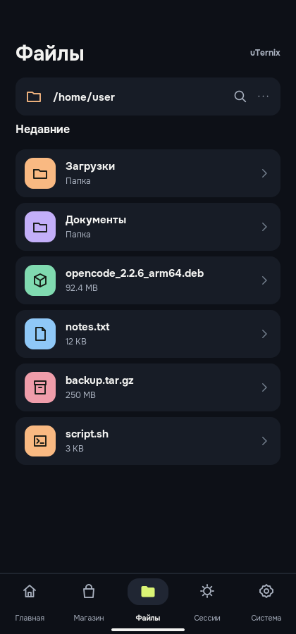
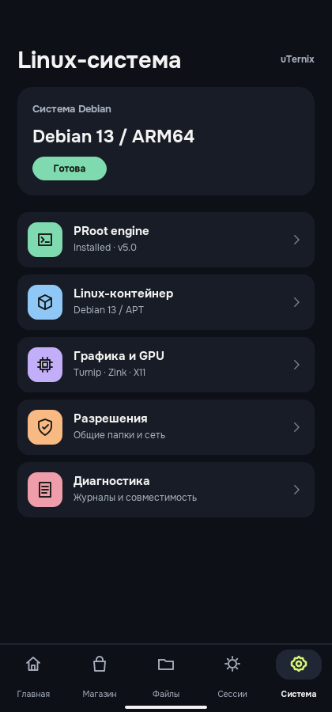

# uTernix

**Linux на Android. Терминал, приложения и пакеты в одном интерфейсе.**

[**Скачать APK**](../../releases) · [**Возможности**](#возможности) · [**Интерфейс**](#интерфейс)

## О приложении

**uTernix** позволяет работать с Linux-окружением прямо на Android-смартфоне или планшете. В приложении объединены терминал, управление установленными программами, файловый менеджер и каталог пакетов.

Для запуска Debian через **PRoot** права root не требуются. Терминал работает в текстовом режиме отдельно от графического рабочего стола — запуск X11 для командной строки не нужен.

## Интерфейс

> Изображения ниже — макеты нового оформления uTernix. Фактический вид и работа функций проверяются на устройстве после сборки APK.

<table>
  <tr>
    <td align="center"> Главная</td>
    <td align="center"> Приложения</td>
    <td align="center"> Пакеты</td>
  </tr>
  <tr>
    <td align="center"> Файлы</td>
    <td align="center"> Настройка</td>
    <td align="center">Тёмная тема Удобная навигация Телефоны и планшеты</td>
  </tr>
</table>

## Возможности

- **Linux без root:** создание и настройка Debian-окружения через PRoot.
- **Терминал:** выполнение команд в текстовом режиме (CUI) без запуска рабочего стола.
- **Приложения:** поиск и запуск установленных Linux-программ с их собственными значками.
- **Пакеты:** управление программами через APT, установка поддерживаемых пакетов `.deb` и отслеживание операций.
- **Файлы:** доступ к файлам Android и Linux-окружения.
- **Рабочий стол:** отдельный графический режим X11 для поддерживаемых приложений.
- **Устройства:** тёмный интерфейс для телефонов и планшетов, включая альбомную ориентацию.

Доступность графики, отдельных пакетов и эмуляции зависит от устройства и установленного Linux-окружения. Поддержка Box64 экспериментальная.

## Скачать и установить

1. Откройте страницу [**Релизы**](../../releases).
2. Выберите последнюю **успешную сборку** и скачайте APK для **ARM64**.
3. Разрешите Android установку приложения из выбранного источника и установите APK.

Если релизов пока нет, значит готовая сборка ещё не опубликована.

**Важно:** тестовые APK, подписанные временным ключом, могут требовать удаления предыдущей версии перед установкой новой. Это может привести к потере локальных данных приложения. Стабильная установка обновлений потребует постоянного ключа подписи.

## Требования

- **Android 7.0 или новее.**
- **64-битный процессор ARM** (`arm64-v8a`).
- Свободное место и подключение к интернету для первичной установки Linux-окружения.
- Root **не нужен** для PRoot; другие режимы могут иметь дополнительные требования.

Устанавливайте пакеты только из доверенных источников: скрипты установки выполняются с разрешениями, предоставленными приложению. PRoot не является полноценной защитной песочницей.

## Исходный код и лицензии

uTernix — независимый проект с открытым исходным кодом. Основной код распространяется на условиях [GPL-3.0](LICENSE).

Используются компоненты [Tessera](https://github.com/daryan044/tessera-linux), [Box64](https://github.com/ptitSeb/box64) и [Termux:X11](https://github.com/termux/termux-x11). Их авторские права и условия лицензирования сохранены в проекте.

Информация для участников разработки находится в [CONTRIBUTING.md](CONTRIBUTING.md).
